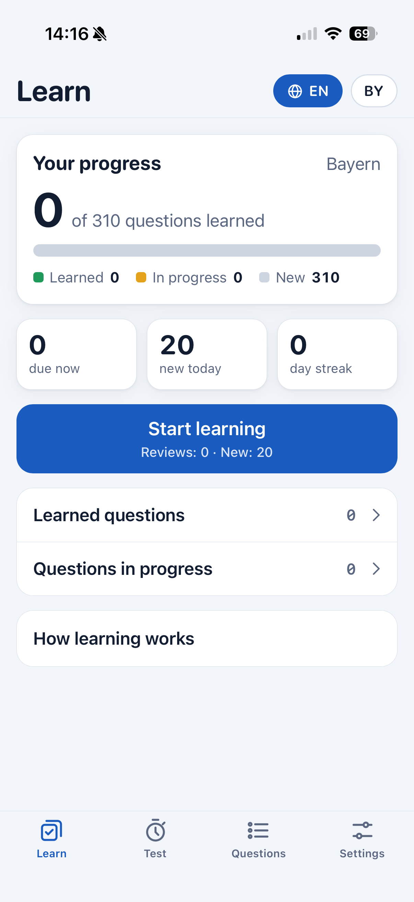
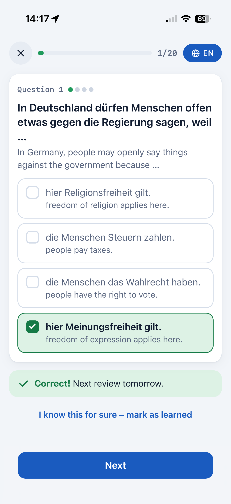

# Leben in Deutschland – Trainer

Offline-capable study app (PWA) for the German citizenship test, served at
<https://artsiomkaval.com/lebenindeutschland/>.

- All 460 official questions: 300 general and 10 for each of the 16 federal states, with the
  BAMF answer key and pictures.
- English and Russian translations as optional hints under the German text.
- Three modes: learning with spaced repetition, tests (mock exam and quick test) with history, and
  browsing.

<p>
  
  
</p>

## Build

You need Python 3.11+, poppler-utils, ImageMagick and Node 22+; `uv` and Google Chrome only for
linting and the end-to-end test.

```sh
make            # build dist/lebenindeutschland/ (downloads the BAMF catalogue PDF on first run)
make serve      # preview at http://127.0.0.1:8787/lebenindeutschland/
```

To publish, copy `dist/lebenindeutschland/` into the website so that it is served at
`/lebenindeutschland/`.

The questions and answer key are kept in `data/questions.json`. When BAMF publishes a new
catalogue, `make refresh` downloads the PDF and the official answers from the BAMF Online-Testcenter
again and rebuilds everything; see [AGENTS.md](AGENTS.md#updating-the-questions).

## Development

```sh
make setup      # install linters, formatters and the e2e driver
make format     # black, isort, eslint --fix, prettier
make check      # lint, type-check and validate the data
make e2e        # click through every mode in headless Chrome
```

[AGENTS.md](AGENTS.md) describes the layout, the build pipeline and how to add a language.

## How learning works

Every question goes through levels 0 (new), 1 (just missed), 2–4 (learning) and 5 (learned).
A correct answer moves it up one level and schedules the next review 1, 2 or 4 days later.
The fourth correct answer in a row marks it learned. A wrong answer resets it to level 1, and it
comes back in the same session. Mistakes in tests are sent back to learning too. Sessions have at
most 20 cards: due reviews first, then new questions up to the daily limit.

All progress is stored in `localStorage` on the device and can be exported and imported as JSON
in Settings.

## License and sources

- The code and the English and Russian translations are licensed under the [MIT License](LICENSE).
- The German questions and answer options in `data/questions.json` are Anlage 1 of the
  Einbürgerungstestverordnung (EinbTestV) of 5 August 2008 (BGBl. I S. 1649), last amended on
  21 June 2024 (BGBl. 2024 I Nr. 211), in the wording of the BAMF
  [Gesamtfragenkatalog](https://www.bamf.de/SharedDocs/Anlagen/DE/Integration/Einbuergerung/gesamtfragenkatalog-lebenindeutschland.html),
  Stand 07.05.2025. They are official works without copyright (§ 5 UrhG) and are not covered by
  the MIT License.
- The correct answers come from the BAMF
  [Online-Testcenter](https://oet.bamf.de/ords/oetut/f?p=514:1:0).
- The pictures are not stored in this repository. The build crops them from the BAMF catalogue
  PDF. The five photos that the PDF credits to the Federal Government and the Bundestag are
  replaced with the versions printed in Anlage 1 of the regulation, which are free to reuse.
- This app is not affiliated with BAMF. The translations are unofficial learning aids. The coats
  of arms of the federal states are shown only for civic education, as in the official catalogue.
